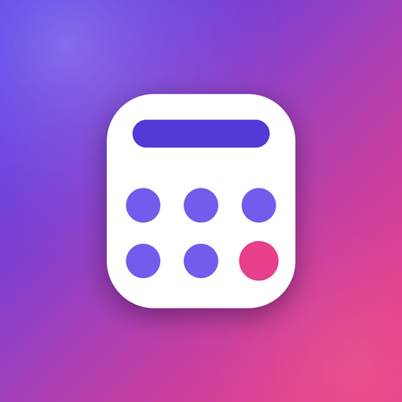

# MD3 Calculator — нативный Android (Kotlin + Jetpack Compose)



Полностью нативное приложение-калькулятор. Без HTML, JavaScript, WebView и
браузерных движков — только Kotlin, Jetpack Compose и Material 3 Expressive.

| Параметр | Значение |
|---|---|
| Язык | Kotlin 2.0.21 |
| UI | Jetpack Compose (BOM 2025.12.01), Material 3 1.4.0, XML-лейаутов нет |
| Дизайн | Material 3 Expressive + Dynamic Color (Material You / обои) |
| Моушен | `MotionScheme.expressive()`, spatial spring 0.8 / 380 |
| Версия | 1.1.0 (versionCode 2) |
| Gradle / AGP | 8.9 / 8.7.3 |
| compileSdk / minSdk | 35 / 24 (Android 7.0+) |
| Сборка | GitHub Actions → готовый APK |

Репозиторий: <https://github.com/DeNolisik5/MD3-Calculator>

## Возможности

- Сложение, вычитание, умножение, деление, проценты, смена знака.
- **AC** — полный сброс, **⌫** — удалить последний символ, **.** — точка, **=** — результат.
- Умный парсер с приоритетом операций (`2+3×4 = 14`), контекстными процентами
  (`200+10% = 220`, `200−10% = 180`, `200×10% = 20`), точной арифметикой на
  `BigDecimal` (`0.1+0.2 = 0.3`) и живым предпросмотром результата.
- Деление на ноль не роняет приложение: показывается понятное сообщение,
  выражение остаётся на экране.
- Состояние в `ViewModel` + `StateFlow`, продублировано в `SavedStateHandle`:
  поворот экрана и даже смерть процесса выражение не теряют.
- Dynamic Color: на Android 12+ палитра берётся из обоев, ниже — собственная
  «выразительная» фиолетово-розовая тема. Тёмная тема — по системной настройке.
- Haptic feedback на каждое нажатие: платформенный key-tick + короткая
  `EFFECT_TICK`; для «=» — более ощутимый `EFFECT_CLICK`.
- Кнопки в духе M3 Expressive: в покое — таблетка (`percent = 50`), при нажатии
  радиус плавно морфится в токен *large increased* (20dp). Геометрия живёт на
  `MotionScheme.expressive().defaultSpatialSpec()` — это
  `spring(dampingRatio = 0.8f, stiffness = 380f)`, поэтому клавиша слегка
  «перелетает» и пружинит. Цвет — на `defaultEffectsSpec()`.
- Анимации нажатия: пружинный scale и elevation, плавная смена цвета, «дыхание»
  шрифта на длинном выражении, появление предпросмотра и ошибок.
- Адаптивная вёрстка: портрет — колонка, ландшафт — компактный режим.

## Что нового в 1.1.0

- Material 3 **1.4.0** (Compose BOM 2025.12.01) — первый стабильный M3E-релиз.
- `MotionScheme.expressive()` подключён в `CalculatorTheme`.
- Клавиши морфятся: покой — pill, нажатие — 20dp, радиус анимируется
  `defaultSpatialSpec` (spring 0.8 / 380) с лёгким overshoot.
- Цвет, тень и масштаб переведены на M3E-спринги, ripple обрезается по
  анимированной форме (`clip(shape)`).

## Структура проекта

```
native-calculator/
├── .github/workflows/build.yml        # сборка APK в облаке
├── app/
│   ├── build.gradle.kts
│   ├── proguard-rules.pro
│   └── src/
│       ├── main/
│       │   ├── AndroidManifest.xml
│       │   ├── java/com/narezany/calculator/
│       │   │   ├── MainActivity.kt
│       │   │   ├── calc/
│       │   │   │   ├── CalculatorEngine.kt    # парсер и арифметика (BigDecimal)
│       │   │   │   └── CalculatorViewModel.kt # StateFlow + SavedStateHandle
│       │   │   └── ui/
│       │   │       ├── CalculatorScreen.kt    # весь UI на Compose
│       │   │       ├── Haptics.kt
│       │   │       └── theme/                 # Color.kt, Theme.kt, Type.kt
│       │   └── res/                           # строки, темы, adaptive-иконки
│       └── test/java/com/narezany/calculator/CalculatorEngineTest.kt
├── docs/icon-512.png
├── gradle/wrapper/…
├── tools/make_icon.py                 # генератор иконки (Python + Pillow)
├── build.gradle.kts
├── settings.gradle.kts
├── gradle.properties
├── gradlew / gradlew.bat
└── README.md
```

## Локальная сборка

Нужны JDK 17 и Android SDK (проще всего — Android Studio).

```bash
# из папки native-calculator
chmod +x gradlew          # только для Linux/macOS
./gradlew :app:assembleDebug

# юнит-тесты движка выражений
./gradlew :app:testDebugUnitTest

# готовый APK: app/build/outputs/apk/debug/app-debug.apk
```

Либо откройте папку в Android Studio и нажмите Run.

## Как загрузить на GitHub

Репозиторий уже создан: <https://github.com/DeNolisik5/MD3-Calculator>.
Из папки `native-calculator` (в ней лежат `app/`, `.github/`, `gradlew`):

```bash
git init
git add .
git commit -m "Native Compose calculator"
git branch -M main
git remote add origin https://github.com/DeNolisik5/MD3-Calculator.git
git push -u origin main
```

Важно: загружать нужно **содержимое** папки `native-calculator`, а не саму папку,
иначе `.github/workflows/build.yml` окажется не в корне репозитория.

При запросе пароля вместо пароля вводится Personal Access Token
(GitHub → Settings → Developer settings → Tokens). Токен нигде в проекте не
хранится; после первой загрузки его лучше отозвать и создать новый.

## Как скачать APK

Быстрее всего — со страницы релизов:
<https://github.com/DeNolisik5/MD3-Calculator/releases> — там к релизу
`v1.1.0` прикреплён готовый `app-debug.apk`.

Либо соберите сами через Actions:

1. Откройте репозиторий → вкладка **Actions**.
2. Слева выберите workflow **Build APK** → последний запуск.
3. Дождитесь зелёной галочки (первый раз 5–10 минут: качаются Gradle и зависимости,
   дальше быстрее за счёт кэша).
4. Внизу страницы, блок **Artifacts**:
   - `native-calculator-debug-apk` — установочный APK (debug-подпись);
   - `native-calculator-release-apk` — с R8, тоже debug-подпись для удобства.
5. Скачайте ZIP, распакуйте — внутри `app-debug.apk`.
6. Перенесите APK на телефон и установите, разрешив «Установка из неизвестных
   источников» для файлового менеджера или браузера.

Сборка запускается на каждый `push` в `main`, а также вручную:
**Actions → Build APK → Run workflow**.

## Архив проекта

Рядом лежит `native-calculator.zip` — тот же проект (без `.git`), если нужно
передать его или распаковать заново.

## Пересобрать иконку

```bash
pip install --break-system-packages pillow
python3 tools/make_icon.py
```

Скрипт рисует иконку с нуля: градиент, белая «карточка» калькулятора, дисплей и
клавиши, акцентная клавиша «=»; раскладывает PNG по всем плотностям
(adaptive foreground/background/monochrome, legacy, круглая) и `docs/icon-512.png`.

## Release-подпись (для публикации)

Сейчас release подписан debug-ключом, чтобы APK из Actions сразу устанавливался.
Для настоящего релиза создайте свой keystore:

```bash
keytool -genkeypair -v -keystore release.keystore -alias calc \
        -keyalg RSA -keysize 2048 -validity 10000
```

и замените `signingConfig = signingConfigs.getByName("debug")` в
`app/build.gradle.kts` на свою конфигурацию (ключ и пароли — в GitHub Secrets).

## Примечания

- Dynamic Color работает на Android 12+; ниже — фирменная фиолетово-розовая тема.
- Приложение не требует интернета и не собирает данных.
- Единственное разрешение — `VIBRATE` (виброотклик).

## Лицензия

MIT — см. `LICENSE`.
